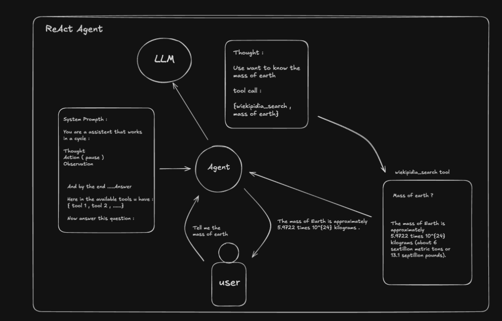

MCP ( Model Context Protocol ) Hugging Face course : 

https://huggingface.co/learn/mcp-course/unit0/introduction

29th Oct :  Thought - Action - Observation Cycle in Agents 

 

15th Nov : 

 Unit 1 completed ( agent course )

https://www.pinecone.io/learn/retrieval-augmented-generation/ ( RAG ) 